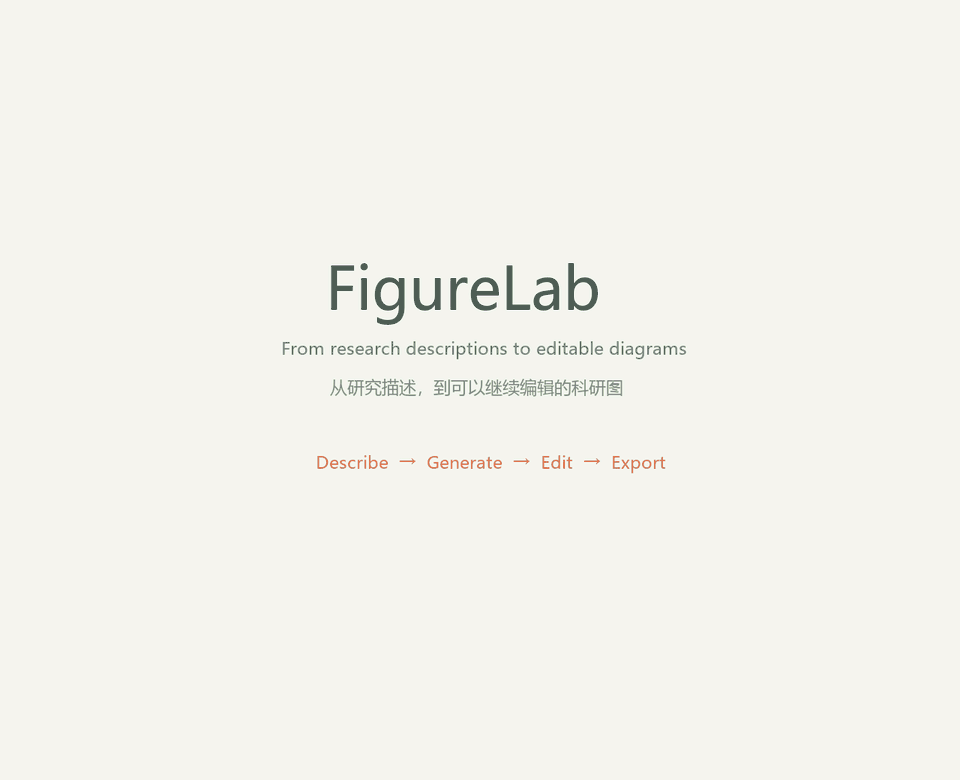
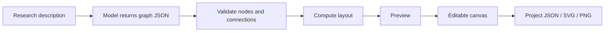

# FigureLab

**Turn research descriptions into editable scientific diagrams.**

[English](README.md) · [简体中文](README.zh-CN.md) · [Quick start](#quick-start) · [Configuration](docs/configuration.md)

[](https://github.com/COZLQ/figurelab/actions/workflows/ci.yml)



*Actual app capture, edited into a short walkthrough; waiting is shortened. [Watch the MP4](docs/assets/demo.mp4).*

FigureLab is a local-first diagram editor for research workflows, study designs, and model architectures. Describe your research, inspect the generated structure, then refine every label, shape, and connector on the canvas.

## What you can do

- **Generate a diagram from text.** Connect DeepSeek or a Chat Completions-compatible service using your own API key.
- **Review before applying.** Validate the graph, inspect uncertainty notes, pan and zoom the preview, then place it on the canvas.
- **Keep editing.** Drag and resize modules, change labels and colors, create connections, and undo or redo changes.
- **Save your work.** Autosave in the current browser, or download and re-import a project JSON file.
- **Export vector objects.** SVG contains native text, shapes, and paths; PNG provides a white-background raster export.
- **Work without an API key.** Templates, manual editing, project files, and exports are available independently of AI.

The current interface is in Simplified Chinese. English documentation is provided.

## Quick start

Use **Node.js 24.x** and **pnpm 11.25.0**. Clone the repository and start the editor:

```sh
git clone https://github.com/COZLQ/figurelab.git
cd figurelab
pnpm install --frozen-lockfile
pnpm dev
```

If you downloaded the source ZIP, extract it and run the two `pnpm` commands inside its project directory.

Open [http://127.0.0.1:3000](http://127.0.0.1:3000). Start from a template, or import a file from [examples/](examples/).

If pnpm is not installed, install the pinned version with `npm install --global pnpm@11.25.0` after installing Node.js. On Windows, `start-local.cmd` can start an already-installed checkout.

## Generate your first figure

1. Click **AI 生成** in the top bar.
2. Open **模型连接** and enter your provider's base URL, model name, and API key.
3. Write a research description and choose the diagram type and layout direction.
4. Click **生成可编辑图形**. Review the preview and any items requiring author confirmation.
5. Click **放入画布** to apply the result. Continue editing or export it.

Session keys remain in page memory and must be entered again after a refresh. For optional server-side configuration, see [.env.example](.env.example) and the [configuration guide](docs/configuration.md).

## Examples

| Example | Editable project | SVG | PNG |
| --- | --- | --- | --- |
| Research workflow | [JSON](examples/research-workflow.figurelab.json) | [SVG](examples/research-workflow.svg) | [PNG](examples/research-workflow.png) |
| Study design | [JSON](examples/study-design.figurelab.json) | [SVG](examples/study-design.svg) | [PNG](examples/study-design.png) |
| Model architecture | [JSON](examples/model-architecture.figurelab.json) | [SVG](examples/model-architecture.svg) | [PNG](examples/model-architecture.png) |

These examples illustrate diagram structure. They do not establish scientific findings.

The walkthrough's [editable AI example](examples/ai-material-defect.figurelab.json) is also included with its [SVG](examples/ai-material-defect.svg) and [PNG](examples/ai-material-defect.png). [Recording details](docs/demo-storyboard.md).

## How it works



The model supplies structure; layout and rendering are implemented by the application. Model-authored HTML, SVG, or scripts are not executed. See the [architecture notes](docs/architecture.md).

Built with Next.js, React, TypeScript, React Flow, Dagre, Zod, and Zustand. Dependency licenses are listed in [THIRD_PARTY_NOTICES.md](THIRD_PARTY_NOTICES.md).

## Development

```sh
pnpm typecheck
pnpm test
pnpm check:release
pnpm build
pnpm start
```

Stop the development server before building in the same checkout, as both use `.next`. [CONTRIBUTING.md](CONTRIBUTING.md) explains the development workflow.

## Scope and limits

- AI output is limited to 20 modules and 45 connections per request, with a 60-second provider timeout.
- Scientific content, causal relationships, and suggested methods require author review.
- Autosave keeps one recent project per browser and origin. Download project files for backups; use one editing tab at a time.
- SVG text depends on fonts installed on the receiving device. Compatibility with third-party vector editors has not been exhaustively tested.
- Long labels may wrap or be shortened visually; increasing module dimensions can help.
- v0.1 has no accounts, cloud project storage, collaboration, or built-in access control for a public service. AI routes require a running Node.js server; a static-only host cannot run them.

Provider costs and data handling follow the provider you configure. Review [SECURITY.md](SECURITY.md) before exposing a server configured with a shared key.

## Project status

The v0.1.0 release candidate has passed local type checks, 48 automated tests, browser workflow checks, and a production build on Windows. A real DeepSeek request has also been verified. The included GitHub Actions workflow is ready for its first remote run after publication.

See [validation details](docs/validation.md), the [changelog](CHANGELOG.md), and the [release checklist](docs/release-checklist.md).

## License

[MIT](LICENSE) for FigureLab source code. Third-party dependencies retain their own licenses.
