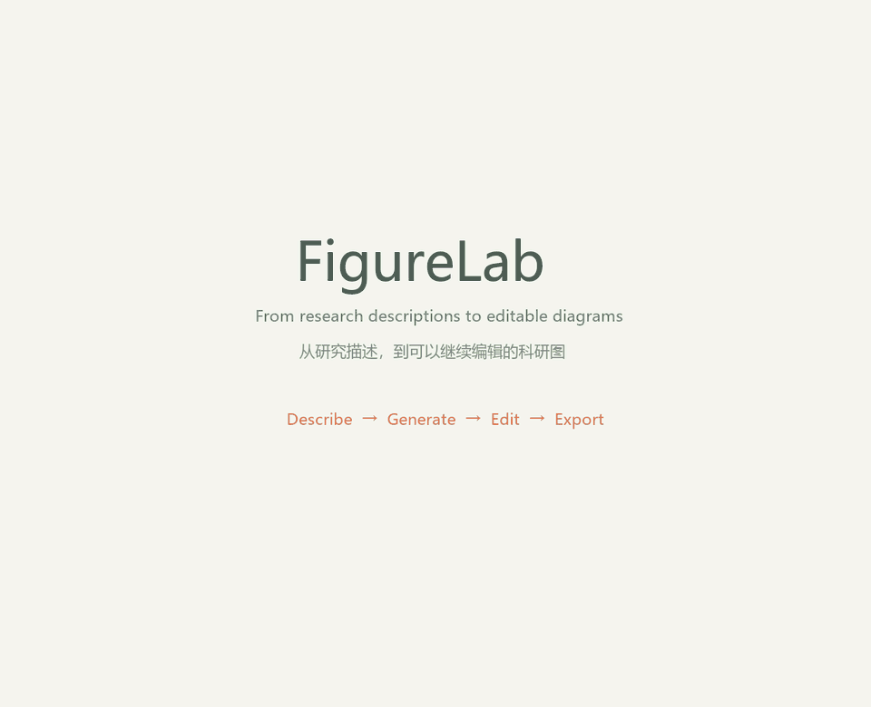

# FigureLab

**把研究描述，变成可以继续编辑的科研图。**

[English](README.md) · [简体中文](README.zh-CN.md) · [AI 配置](docs/configuration.md)

[](https://github.com/COZLQ/figurelab/actions/workflows/ci.yml)



真实应用操作关键步骤剪辑，等待片段已缩短。[观看 MP4](docs/assets/demo.mp4)。

FigureLab 是面向研究流程、实验设计和模型架构的本地图形编辑器。输入研究描述，核对生成结构后放入画布，继续调整文字、形状和连接，最后保存项目或导出图片。

## 功能

- **描述生成图形**：连接 DeepSeek 或 Chat Completions 兼容服务，使用自己的 API Key。
- **先预览再应用**：校验模块和连接，展示待核对事项，支持缩放、平移和展开查看。
- **逐个对象编辑**：拖动、调整尺寸、改字、换色、连接模块，支持撤销和重做。
- **项目保存**：浏览器自动保存，并可下载项目 JSON 后重新导入。
- **矢量导出**：SVG 保留原生文字、形状和路径；PNG 输出白色背景图片。
- **无需密钥也能画图**：模板、手动编辑、项目文件和导出可独立使用。

当前界面为简体中文，同时提供英文说明。

## 本地启动

使用 **Node.js 24.x** 和 **pnpm 11.25.0**。克隆仓库并启动编辑器：

```sh
git clone https://github.com/COZLQ/figurelab.git
cd figurelab
pnpm install --frozen-lockfile
pnpm dev
```

如果下载了源码 ZIP，先解压，再在项目目录运行上面的两条 `pnpm` 命令。

打开 [http://127.0.0.1:3000](http://127.0.0.1:3000)，选择模板，或导入 [examples/](examples/) 中的项目文件。

尚未安装 pnpm 时，可在安装 Node.js 后运行 `npm install --global pnpm@11.25.0`。Windows 下，已安装依赖的项目也可以双击 `start-local.cmd` 启动。

## 第一次使用 AI

1. 点击顶部 **AI 生成**。
2. 在 **模型连接** 填写服务地址、模型名称和自己的 API Key。
3. 输入研究描述，选择图形类型与排列方向。
4. 点击 **生成可编辑图形**，检查预览和待核对事项。
5. 点击 **放入画布**，再继续编辑、保存或导出。

默认配置为 DeepSeek。使用其他兼容服务时，填写服务商提供的地址和模型名称。会话密钥只保留在当前页面内存，刷新后需重新填写。可选的服务端配置见 [.env.example](.env.example) 和 [配置指南](docs/configuration.md)。

预览支持缩放、拖动、实际大小、适应窗口和展开查看。重新生成失败或取消时会保留上一份预览；描述变化后，旧结果会被明确标识。所有重试均由用户手动触发。

## 示例项目

| 示例 | 可编辑项目 | SVG | PNG |
| --- | --- | --- | --- |
| 研究流程 | [JSON](examples/research-workflow.figurelab.json) | [SVG](examples/research-workflow.svg) | [PNG](examples/research-workflow.png) |
| 实验设计 | [JSON](examples/study-design.figurelab.json) | [SVG](examples/study-design.svg) | [PNG](examples/study-design.png) |
| 模型架构 | [JSON](examples/model-architecture.figurelab.json) | [SVG](examples/model-architecture.svg) | [PNG](examples/model-architecture.png) |

示例用于展示图形组织方式，不代表科学结论。

演示中的 [AI 图形项目](examples/ai-material-defect.figurelab.json) 也附有 [SVG](examples/ai-material-defect.svg) 和 [PNG](examples/ai-material-defect.png)，可直接导入继续编辑。[演示说明](docs/demo-storyboard.md)。

## 实现方式

**研究描述 → 模型返回图形 JSON → 校验模块与连接 → 自动排版 → 预览 → 可编辑画布 → 项目文件 / SVG / PNG**

模型负责整理结构，应用负责布局和绘制，不执行模型编写的 HTML、SVG 或脚本。[架构说明](docs/architecture.md) 记录了数据与模块关系。

主要技术：Next.js、React、TypeScript、React Flow、Dagre、Zod 和 Zustand。依赖许可见 [第三方说明](THIRD_PARTY_NOTICES.md)。

## 开发检查

```sh
pnpm typecheck
pnpm test
pnpm check:release
pnpm build
pnpm start
```

同一目录中，开发服务与正式构建都会使用 `.next`，构建前先停止开发服务。参与开发请阅读 [贡献指南](CONTRIBUTING.md)。

## 当前边界

- 单次 AI 生成最多 20 个模块、45 条连接，模型请求最长等待 60 秒。
- 研究内容、因果关系和实验方法需由作者核对。
- 自动保存只保留当前浏览器、当前地址的一份最近项目；重要内容请下载备份，建议单标签页编辑。
- SVG 的跨设备文字显示依赖字体；尚未逐一验证第三方矢量编辑器兼容性。
- 长文字可能换行或显示省略号，可增大模块尺寸。
- v0.1 尚无账号、云存储、多人协作和公共服务访问控制。AI 接口需要运行 Node.js 服务，静态托管无法单独运行它。

模型费用及数据处理取决于所配置的服务商。若准备公开运行使用共享密钥的服务，先阅读 [安全说明](SECURITY.md)。

## 发布状态

v0.1.0 源码已上传至 [COZLQ/figurelab](https://github.com/COZLQ/figurelab)。Windows 本地类型检查、48 项自动化测试、浏览器操作检查和正式构建已通过，GitHub Actions 的 Linux 检查也已通过，并完成过真实 DeepSeek 请求验证。各版本下载见 [Releases](https://github.com/COZLQ/figurelab/releases)。

详见 [验收记录](docs/validation.md)、[更新记录](CHANGELOG.md) 和 [发布清单](docs/release-checklist.md)。

## 许可

FigureLab 源码采用 [MIT 许可证](LICENSE)，第三方依赖保留各自许可。
