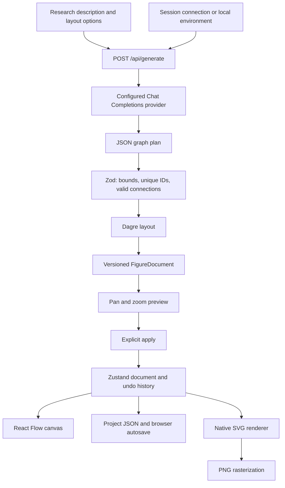

# Architecture

## Evidence-to-figure flow

## Source map

| Area | Source |
| --- | --- |
| Editor and file operations | [editor.tsx](../src/components/editor.tsx) |
| AI input, status, and preview flow | [ai-generator.tsx](../src/components/ai-generator.tsx) |
| Preview gestures and controls | [diagram-preview.tsx](../src/components/diagram-preview.tsx) |
| Request and model-plan validation | [plan.ts](../src/lib/ai/plan.ts) |
| Provider boundary and safe error mapping | [server.ts](../src/lib/ai/server.ts) |
| Canonical document schema | [document.ts](../src/lib/document.ts) |
| Editing history | [store.ts](../src/lib/store.ts) |
| Shared node renderer and exports | [svg.ts](../src/lib/svg.ts) |

## Design choices

The model returns a graph plan rather than coordinates or executable markup. The app validates the graph and computes geometry. Both the interactive module and SVG export use the same node drawing function.

Preview zoom and pan change the viewing transform, not the document coordinates. A successful generation becomes a candidate; applying it is a separate undoable document replacement.

Long requests can be cancelled. Invalid, empty, truncated, or refused provider output does not replace the current canvas. Existing previews remain visible during retries, and changed input is explicitly distinguished from the previous result.

Project JSON is versioned with `version: 1`. Import validation rejects duplicate identifiers and dangling connections. Downloaded documents do not contain connection settings or API keys.

## Deployment boundary

AI routes run on the server. Static hosting alone cannot provide generation. Session keys travel through this server to the operator-configured provider, so a hosted operator is part of that trust boundary. v0.1 targets local or private use; public multi-user authentication and quotas are future work.
